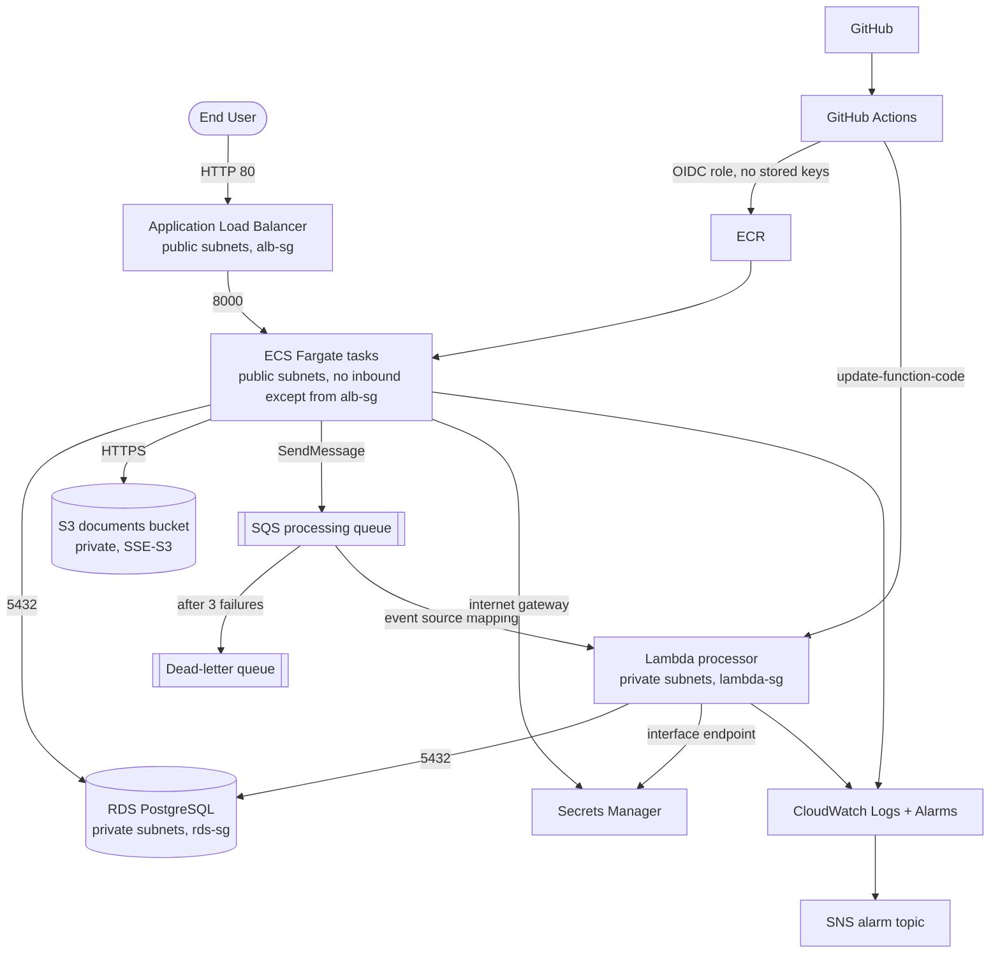

# Architecture Overview

## Document Submission Portal (DSP)

Users upload documents (PDF, DOCX, PNG, JPG, up to 10 MB). The file is stored in a private S3 bucket, metadata and
status are stored in RDS PostgreSQL, and a message on an SQS queue triggers a Lambda that moves the document through
`UPLOADED` ➔ `PROCESSING` ➔ `PROCESSED` (or `FAILED`).

### Architecture Diagram

### Upload flow

1. Browser sends a multipart request to `POST /api/documents`; the backend validates extension, MIME type and size.
2. The backend writes the file to S3 under a generated key (`documents/<uuid>.<ext>`).
3. The backend inserts the metadata row in RDS (status `UPLOADED`). If this fails, the S3 object is deleted.
4. The backend sends `{"document_id": "<uuid>"}` to SQS and returns `201` immediately; the request does not wait for processing.
5. The Lambda consumes the message, sets `PROCESSING`, simulates work, then sets `PROCESSED`.
6. A failing message is retried. On the 3rd failed receive the Lambda marks the document `FAILED` with a safe summary and
   SQS moves the message to the dead-letter queue, which raises a CloudWatch alarm. `POST /api/documents/{id}/retry` re-queues it.

If `QUEUE_URL` is unset or SQS is unreachable, the backend falls back to processing in-process so uploads never break.

### Network topology (`infra/network.yaml`)

- **VPC** `10.0.0.0/16` across 2 Availability Zones.
- **Public subnets** `10.0.1.0/24`, `10.0.2.0/24`: ALB and ECS Fargate tasks.
- **Private subnets** `10.0.11.0/24`, `10.0.12.0/24`: RDS and the processor Lambda.
- **Internet gateway** on the public route table. The private route table has no internet route.

### Why ECS tasks run in public subnets (deliberate cost decision)

The reference design places Fargate in private subnets. That requires either a NAT Gateway (~$32/month each) or
VPC endpoints for ECR (2), CloudWatch Logs, S3 and Secrets Manager (~$29/month for four interface endpoints) so tasks
can pull images and reach AWS APIs. For a capstone this cost is not justified, so tasks are placed in public subnets
with `AssignPublicIp: ENABLED`.

The exposure is controlled, not open:

- `ecs-sg` has **one inbound rule: TCP 8000 from `alb-sg`**. Nothing on the internet can reach a task directly, even
  though it has a public IP.
- RDS stays in private subnets with `PubliclyAccessible: false`; only `ecs-sg` and `lambda-sg` can reach port 5432.
- Moving tasks to private subnets later only requires NAT or endpoints plus changing `AssignPublicIp` and the subnet list
  in `application.yaml`.

The processor Lambda *is* in private subnets, so it uses a single Secrets Manager interface endpoint (~$7/month) instead
of a NAT Gateway. Its security group only allows egress to RDS (5432) and that endpoint (443).

### Security group tiering

| Group | Inbound | Outbound |
| :--- | :--- | :--- |
| `alb-sg` | TCP 80, 443 from `0.0.0.0/0` | default |
| `ecs-sg` | TCP 8000 from `alb-sg` only | default (AWS APIs, RDS) |
| `rds-sg` | TCP 5432 from `ecs-sg` and `lambda-sg` | default |
| `lambda-sg` | none | TCP 5432 to `rds-sg`, TCP 443 to `secrets-endpoint-sg` only |
| `secrets-endpoint-sg` | TCP 443 from `lambda-sg` and `ecs-sg` | n/a |

### IAM separation

| Role | Used by | Permissions |
| :--- | :--- | :--- |
| `dsp-github-deploy-role` | GitHub Actions (OIDC) | ECR push, `ecs:UpdateService`, upload Lambda package, `lambda:UpdateFunctionCode`. No admin, no secrets access. |
| `dsp-task-execution-role` | ECS agent | Pull image from ECR, write logs |
| `dsp-task-role` | Running API container | S3 object access on the documents bucket, read the DB secret, `sqs:SendMessage` on the processing queue |
| `dsp-processor-role` | Lambda | Consume the processing queue, read the DB secret, VPC networking |

The OIDC trust policy requires audience `sts.amazonaws.com` and a subject for this repository only. GitHub sends the
subject in the ID format `repo:<owner>@<ownerId>/<repo>@<repoId>:...`, so both that and the classic format are allowed.

### Monitoring

- **Logs**: `/ecs/dsp-backend` (API) and `/aws/lambda/dsp-processor`, 7-day retention. Logs contain document IDs and
  error class names only, never file contents or credentials.
- **Alarms** (all notify the `dsp-alarms` SNS topic; set `AlarmEmail` on the data stack to receive email):
  - `dsp-alb-target-5xx`: 3 or more backend 5xx responses in 5 minutes
  - `dsp-alb-unhealthy-hosts`: a task failing ALB health checks for 3 minutes
  - `dsp-processing-dlq-not-empty`: a document failed processing 3 times
  - `dsp-processor-lambda-errors`: Lambda invocation errors

### Known limitations

- HTTP only (no Route 53 / ACM certificate); the ALB DNS name is the entry point.
- No user authentication: anyone with the URL can upload, edit and delete. Add Cognito or an OIDC login before real use.
- Processing is simulated (a 2-second delay), as allowed for the basic milestone.
