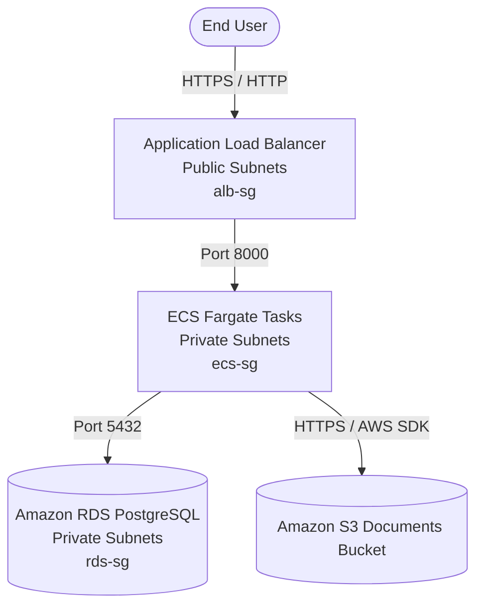

# Architecture Overview

## Document Submission Portal (DSP)

The Document Submission Portal is a cloud-native architecture deployed on AWS designed with multi-tier isolation and least-privilege security.

### Architecture Diagram

### Network Topology (`infra/network.yaml`)

- **VPC**: 1 VPC spanning 2 Availability Zones (`10.0.0.0/16`)
- **Public Subnets**: 2 subnets (`10.0.1.0/24`, `10.0.2.0/24`) for ALB
- **Private Subnets**: 2 subnets (`10.0.11.0/24`, `10.0.12.0/24`) for ECS and RDS
- **Internet Gateway**: Attached to VPC, routed via `PublicRouteTable`
- **Private Route Table**: Isolated from internet traffic

### Security Group Tiering

1. **`alb-sg`**: Allows TCP 80 & 443 inbound from `0.0.0.0/0`.
2. **`ecs-sg`**: Allows TCP 8000 inbound only from `alb-sg`.
3. **`rds-sg`**: Allows TCP 5432 (PostgreSQL) inbound only from `ecs-sg`.
